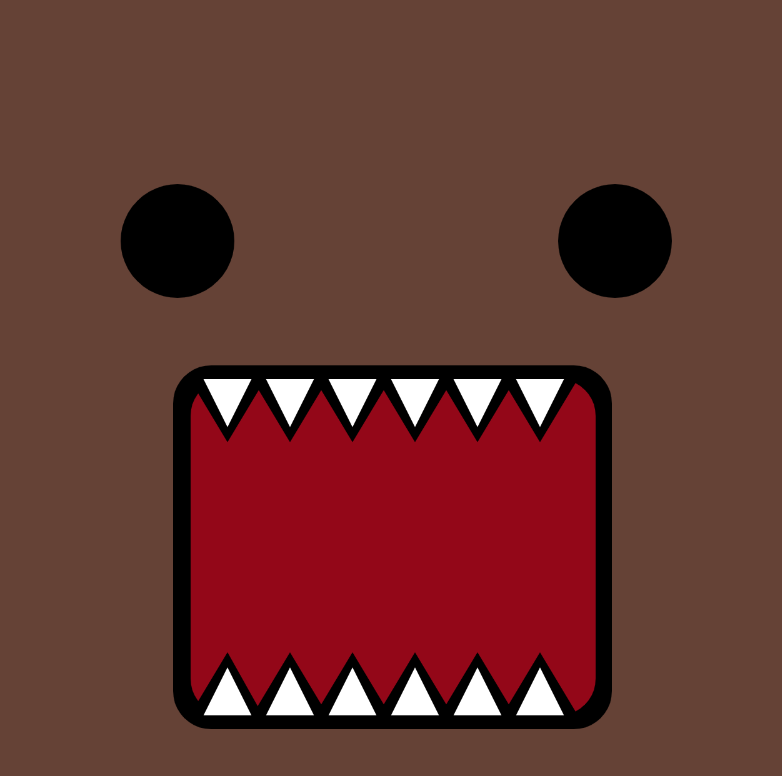
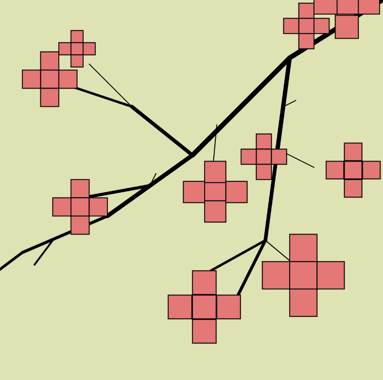
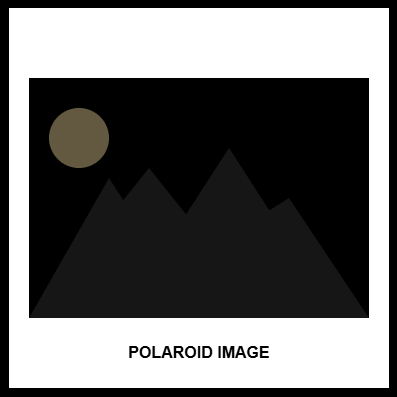
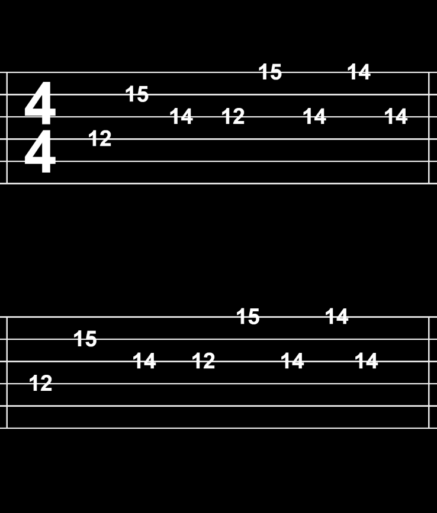
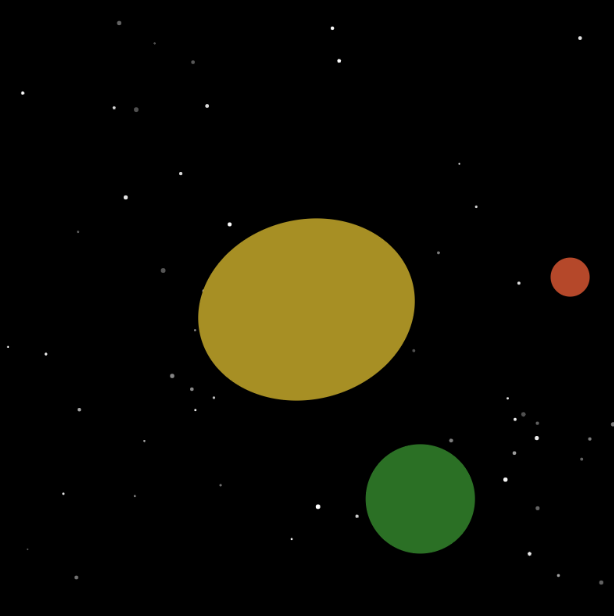
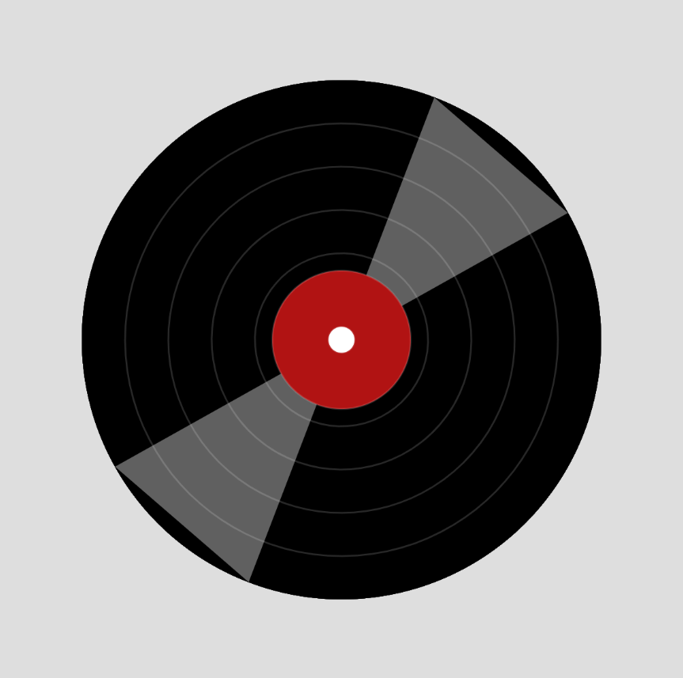
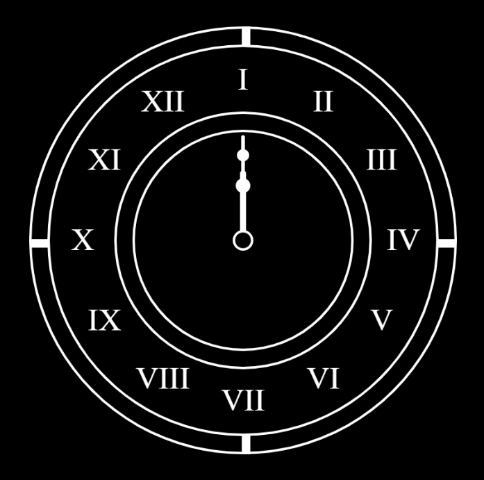
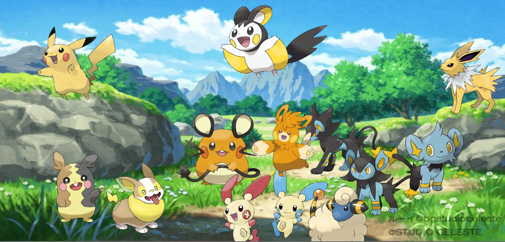

# Erica Galvez's Website

Welcome to my CART 253 website. This is Erica Galvez's coursework space for the course. I will be using this website to show my several different prototypes and projects in order to keep track of my progress throughout this Fall 2026 semester.

## Useful Links

- [Reflective Journal](journal.md)
- [My Github](https://github.com/junyawant)

## Projects + Prototypes

This section is dedicated to my prototypes and projects for CART 253 that will be added here throughout the semester.

### Instructions
#### [PROTOTYPE 1](codingassignments/prototype-instructions/prototype-1/domo-monster/README.md)

1. [View this project online](https://junyawant.github.io/Cart253/codingassignments/prototype-instructions/prototype-1/domo-monster/)
2. [View the code for this project here](https://github.com/junyawant/Cart253/blob/main/codingassignments/prototype-instructions/prototype-1/domo-monster/)

#### [PROTOTYPE 2](codingassignments/prototype-instructions/prototype-2/prototype2/README.md)

1. [View this project online](https://junyawant.github.io/Cart253/codingassignments/prototype-instructions/prototype-2/prototype2/)
2. [View the code for the project here](https://github.com/junyawant/Cart253/blob/main/codingassignments/prototype-instructions/prototype-2/prototype2/js/script.js)

#### [PROTOTYPE 3](codingassignments/prototype-instructions/prototype-3/abstract-art/README.md)

1. [View this project online](https://junyawant.github.io/Cart253/codingassignments/prototype-instructions/prototype-3/abstract-art/)
2. [View the code to the projecct here](https://github.com/junyawant/Cart253/blob/main/codingassignments/prototype-instructions/prototype-3/abstract-art/js/script.js)

### Variables
#### [PROTOTYPE 1](codingassignments/prototype-variables/prototype-1/README.md)

1. [View this project online](https://junyawant.github.io/Cart253/codingassignments/prototype-variables/prototype-1/)
2. [View the code for this project here](https://github.com/junyawant/Cart253/blob/main/codingassignments/prototype-variables/prototype-1/js/script.js)

#### [PROTOTYPE 2](codingassignments/prototype-variables/prototype-2/README.md)

1. [View this project online](https://junyawant.github.io/Cart253/codingassignments/prototype-variables/prototype-2/)
2. [View the code for this project here](https://github.com/junyawant/Cart253/blob/main/codingassignments/prototype-variables/prototype-2/js/script.js)

#### [PROTOTYPE 3](codingassignments/prototype-variables/prototype-3/README.md)

1. [View this project online](https://junyawant.github.io/Cart253/codingassignments/prototype-variables/prototype-3/)
2. [View the code for this project here](https://github.com/junyawant/Cart253/blob/main/codingassignments/prototype-variables/prototype-3/js/script.js)

### Conditionals
#### [PROTOTYPE 1](codingassignments/prototype-conditionals/prototype-1/README.md)

1. [View this project online](https://junyawant.github.io/Cart253/codingassignments/prototype-conditionals/prototype-1/)
2. [View the code for this project here](https://github.com/junyawant/Cart253/blob/main/codingassignments/prototype-conditionals/prototype-1/js/script.js)

#### [PROTOTYPE 2](codingassignments/prototype-conditionals/prototype-2/README.md)

1. [View this project online](https://junyawant.github.io/Cart253/codingassignments/prototype-conditionals/prototype-2/)
2. [View the code for this project here](https://github.com/junyawant/Cart253/blob/main/codingassignments/prototype-conditionals/prototype-2/js/script.js)

#### [PROTOTYPE 3](codingassignments/prototype-conditionals/prototype-3/README.md)

1. [View this project online](https://junyawant.github.io/Cart253/codingassignments/prototype-conditionals/prototype-3/)
2. [View the code for this project here](https://github.com/junyawant/Cart253/blob/main/codingassignments/prototype-conditionals/prototype-3/js/script.js)

### Events
#### [PROTOTYPE 1](codingassignments/prototype-events/prototype-1/README.md)

1. [View this project online](https://junyawant.github.io/Cart253/codingassignments/prototype-events/prototype-1/)
2. [View the code for this project here](https://github.com/junyawant/Cart253/blob/main/codingassignments/prototype-events/prototype-1/js/script.js)

#### [PROTOTYPE 2](/codingassignments/prototype-events/prototype-2/README.md)

1. [View this project online](https://junyawant.github.io/Cart253//codingassignments/prototype-events/prototype-2/)
2. [View the code for this project here](https://github.com/junyawant/Cart253/blob/main/codingassignments/prototype-events/prototype-2/js/script.js)

## Challenges
- [Instructions Challenge](codingchallenges/instructions-challenge/README.md)
- [Variables Challenge](codingchallenges/variables-challenge/mr-furious/README.md)
- [Conditionals Challenge](codingchallenges/conditionals-challenge/README.md)
- [Events Challenge](codingchallenges/events-challenge/README.md)

