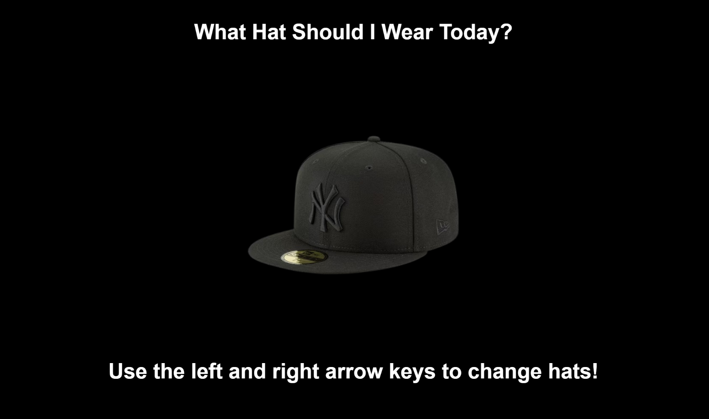

---
---

# Hat of the Day

## Erica Galvez

- [View this project online](https://junyawant.github.io/Cart253//codingassignments/prototype-arrays/prototype-1/)
- [View the code for this project here](https://github.com/junyawant/Cart253/blob/main/codingassignments/prototype-arrays/prototype-1/js/script.js)

## Description

This prototype was more of a personal one. For anyone that does cross paths with me, atleast pretty often, know that I love to wear hats! I have a good collection stacked at home and usually rotate between them depending on my outfit. As I was getting ready to go to work today I figured that using my hat collection in an array would be a great idea!

## How it Works
- Use the Left & Right Arrow Keys to browse through which hat to wear today!

## Attribution

> - This project uses [p5.js](https://p5js.org).
> - This project uses hat images from Amazon that can be found [here](https://www.amazon.ca/ref=nav_logo)
