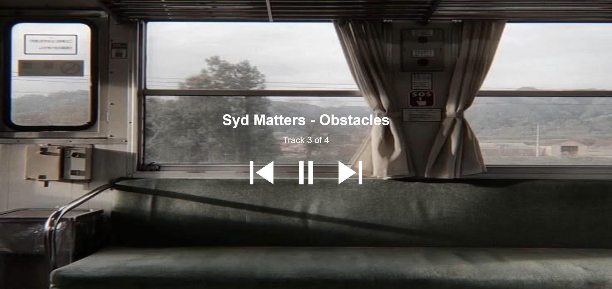

---
---

# Melodies on the Train

AUTHOR NAME

- [View this project online](https://junyawant.github.io/Cart253//codingassignments/prototype-arrays/prototype-2/)
- [View the code for this project here](https://github.com/junyawant/Cart253/blob/main/codingassignments/prototype-arrays/prototype-2/js/script.js)

## Description

An array using sounds! This prototype is meant to emulate that feeling when you are going home on the train/metro, listening to music after a long day. It's one of those days where you are deep in thought, listening to a variety of songs that are slow, some taken from the game: Life is Strange.

## How it Works
- Use the LMB to click on the play button to begin listening to music
- Use the LMB to click to the next song or the previous one you were listening to

## Attribution

> - This project uses [p5.js](https://p5js.org).
> - This project uses youtube videos converted to mp3 audios. (see below)

The Youtube Links to each song:
> - [Syd Matters - To all of you](https://www.youtube.com/watch?v=AoHFCLxTkE4)
> - [Syd Matters - Obstacles](https://www.youtube.com/watch?v=jb1SkDjaXk8)
> - [Conan Gray - Astronomy](https://www.youtube.com/watch?v=PNKxAWiu4Fc)
> - [Sufjan Stevens- Futile devices]https://www.youtube.com/watch?v=-X8pMHtcqvc