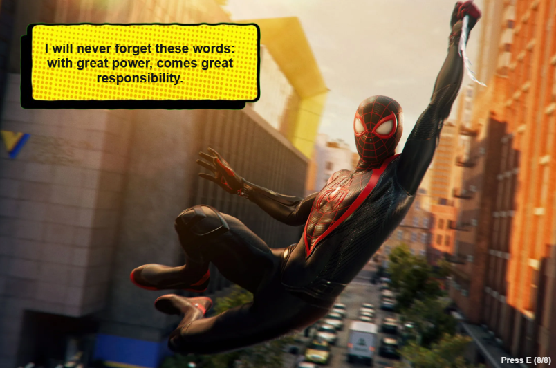

---
---

# Spiderman: Words of Inspiration

## Erica Galvez

- [View this project online](/codingassignments/prototype-arrays/prototype-3/)
- [View the code for this project here](https://github.com/junyawant/Cart253/blob/main/codingassignments/prototype-arrays/prototype-3/js/script.js)

## Description

Following the justice done in the neighborhood, Spiderman has said many different inspirational quotes in many of the movies of the franchise. My goal for this prototype was to use arrays with text in a way that would look visually cool as well. 
The project aims to inspire those who are big fans of the Spiderman series! Speak with spiderman as he swings around the city!

## How it Works

- Press E on your keyboard and read through the several different inspiring quotes from a variety of the Spiderman movies!

## Attribution

> - This project uses [p5.js](https://p5js.org).
> - This project uses quotes from [here](https://collider.com/spider-man-quotes-ranked/)
> - This project uses a textbox image from [here](https://www.youtube.com/watch?v=xAl_-NIwBuI)