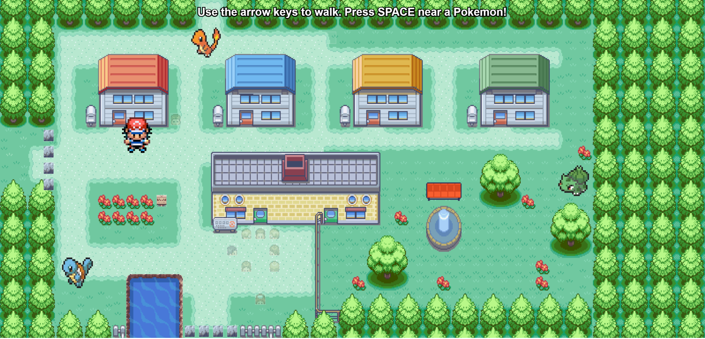

---
---

# Catch All the Starters!

## Erica Galvez

- [View this project online](https://junyawant.github.io/Cart253//codingassignments/prototype-events/prototype-2/)
- [View the code for this project here](https://github.com/junyawant/Cart253/blob/main/codingassignments/prototype-events/prototype-2/js/script.js)

## Description

This project is meant to imitate those old pokemon games that first released in pixelated versions, on early DS handheld consoles. You walk around the map finding the 3 most popular starter pokemons and catch them all!

## How It Works
- Use the arrow keys to move Ash Ketchum around the map
- Once near a pokemon, press SPACE to capture it with your pokeball!

## Attribution

> - This project uses [p5.js](https://p5js.org).
> - The background image can be found [here](https://wallpapercave.com/w/wp14062133)
> - The image for Ash Ketchum can be found [here](https://in.pinterest.com/pin/27443878974492426/)
> - The images for the pokemon(s) can be found [here](https://www.ebay.ca/itm/165681689613)
