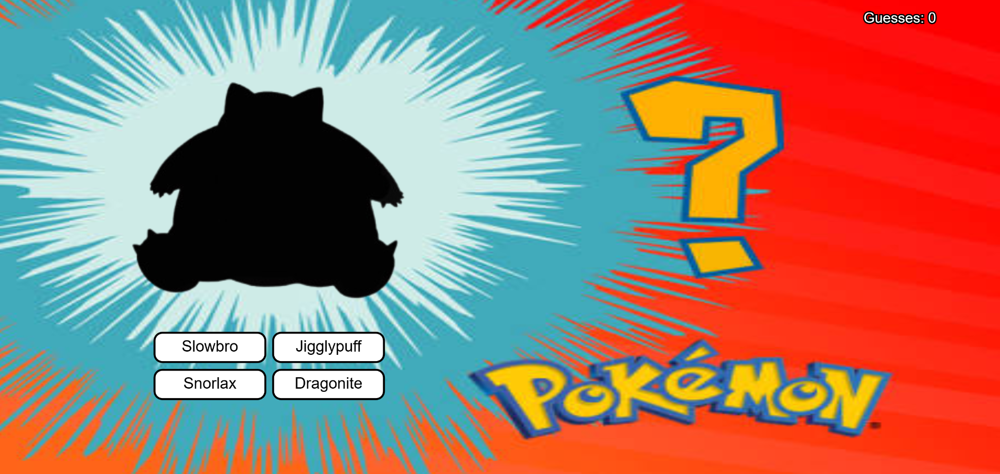

---
---

# Who's That Pokemon?

## Erica Galvez

- [View this project online](https://junyawant.github.io/Cart253//codingassignments/prototype-events/prototype-3/)
- [View the code for this project here](https://github.com/junyawant/Cart253/blob/main/codingassignments/prototype-events/prototype-3/js/script.js)

## Description

This prototype is inspired by the famous pokemon scenes (mostly made into memes these days) of a blacked out pokemon waiting to be revealed. In this case, you are given many different options to choose from before getting the right answer! 

## How It Works
- Using your LMB, hover over the button in order to guess the right name of the Pokemon!

## Attribution

> - This project uses [p5.js](https://p5js.org).
> - The background image can be found [here](https://www.deviantart.com/amitlu89/art/Who%27s-that-Pokemon-254910939)
> - The snorlax image can be found [here](https://www.pokemon.com/us/pokedex/snorlax)