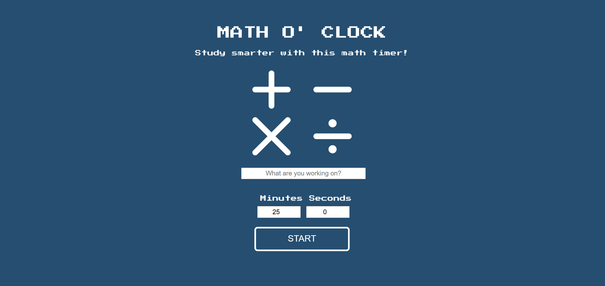

---
---

# Math O' Clock

## Erica Galvez

- [View this project online](https://junyawant.github.io/Cart253//codingassignments/prototype-functions/prototype-1/)
- [View the code for this project here](https://github.com/junyawant/Cart253/blob/main/codingassignments/prototype-functions/prototype-1/js/script.js)

## Description

My vision for this prototype was to create a countdown timer that could be helpful for me at work. On thursday afternoons, I tutor a 5-6th grade math class and frequently use timers with my students (For example: completing 50 multiplications in 2-3 minutes). Creating this countdown timer is extremely beneficial for me as I dislike being seen on my phone infront of my students, being able to project this code on the screen as well also gives them a sense of how much time is left before the countdown is over!

## How it Works
- Use your mouse to interact with the project
- Put in your desired numbers into the timer (Minutes + Seconds)
- Hit START to begin the timer

## Attribution

> - This project uses [p5.js](https://p5js.org).
> - Project font can be found [here](https://fonts.google.com/specimen/Press+Start+2P)