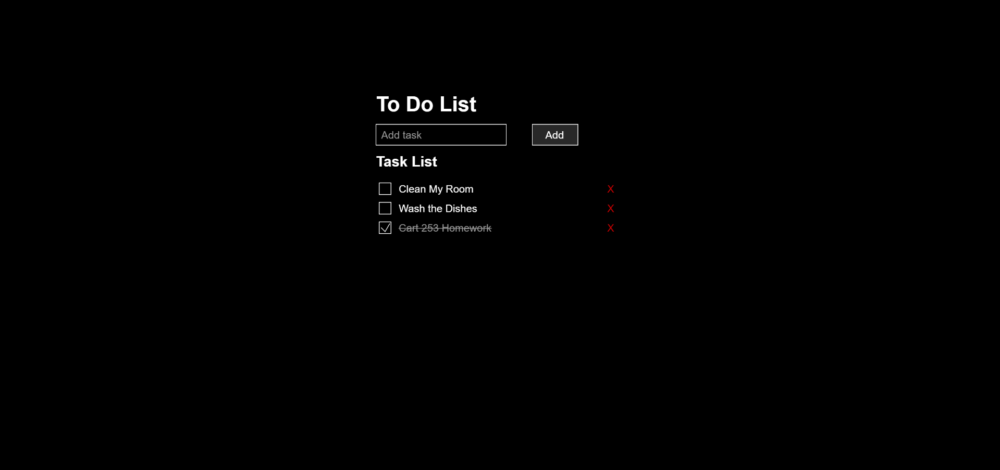

---
---

# To Do List!

## Erica Galvez

- [View this project online](https://junyawant.github.io/Cart253//codingassignments/prototype-functions/prototype-2/)
- [View the code for this project here](https://github.com/junyawant/Cart253/blob/main/codingassignments/prototype-functions/prototype-2/js/script.js)

## Description

This prototype was an attempt at creating a simple to do list! I've seen this been done a lot more straight forwardly with HTML but wanted to give it a try with p5.js! A much more simple and easier prototype than the previous, more complex one (prototype 1) (in my opinion atleast).

I was equally inspired to do this project due to a topic brought up at work where someone asked how others kept track of the things they need to get done in a week. I typically use google calendar but thought creating this may be useful for me in the future!

## How it Works
- Use your mouse to interact with the boxes/buttons on screen!
- Use the input box "Add Task" and write in something (using your keyboard), you need to get done!
- Once the task is done, hit the checkbox to display it as completed!

## Attribution

> - This project uses [p5.js](https://p5js.org).
