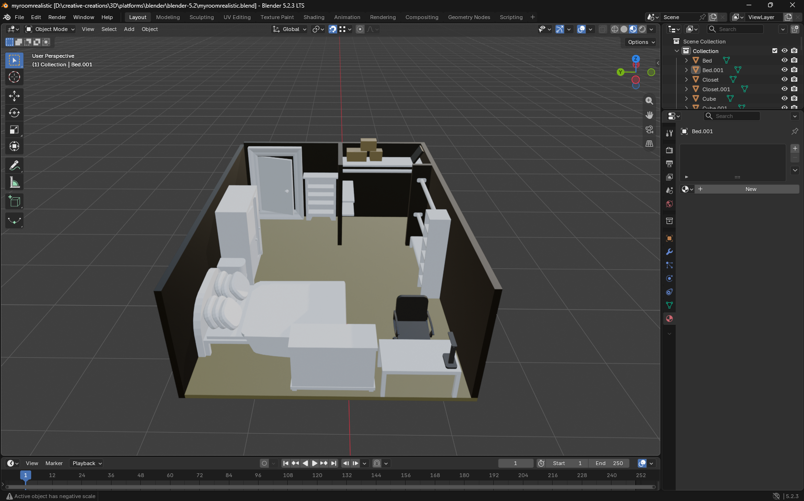
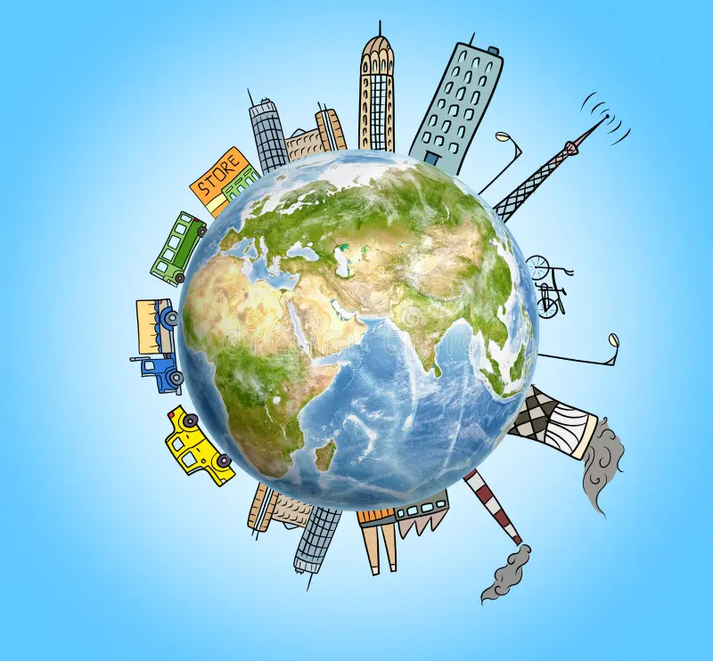

# Erica Galvez's Final Prototype

## IDEATION

### THEMES OPTIONS
1. Childhood
2. Love
3. Cultural (Philippines)
4. Card Deck (Combine with final for 214?)
5. Sports

## DOCUMENTATION/PROCESS

### WEEK 1 PROGRESS

#### First Blender Prototype

Last week, I spent my class time making this rough draft of a blender scene, which is meant to mimic my very own room at home. 

While I have had many ideas for this project (like the use of planet, and buildings sticking out like in the image below), I ultimately changed my mind. 

I find that working with the planet's overall shape would limit me a lot artistically and even possibly complicate things for me. Nonetheless, my vision for my final prototype is to create an interactive room, using webGL. While I've made a number of projects usings webGL in college for assignments, I am definitely challenging myself to see just what potential I have in creating things I find meaningful/beautiful which fit my artistic views (I mean this in a way that I often feel as if I dont translate my ideas for projects in a way that succesfully feels portfolio kind of material). 

I feel as though this project will be a fun yet difficult process for me, as it not only combines code, which I am excited to learn more and more about as I continue to make prototypes (for school or personal projects), but as well as 3D models. (ideally my own work) While I wouldnt say that I am the best at 3D modeling, I hope to learn a lot throughout the process of this singular, big prototype over the course of the next 4 weeks.
